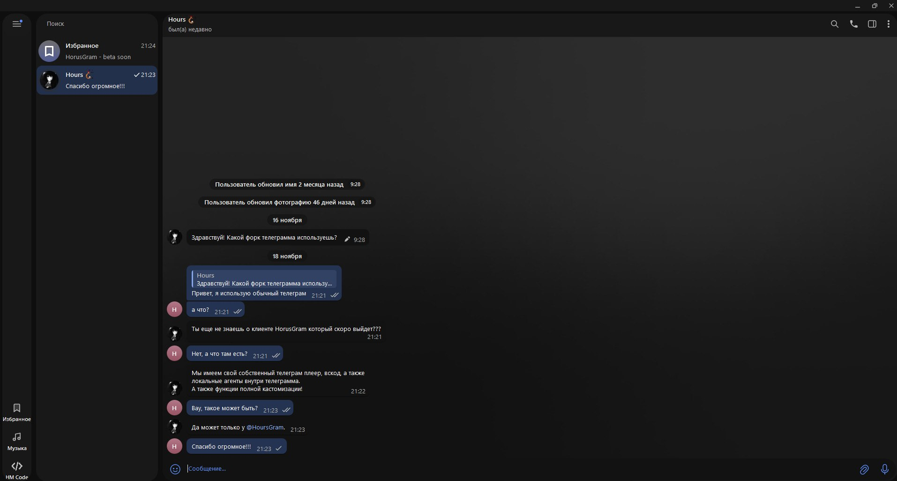

<p align="center">
  
</p>

<h1 align="center">HorusGram Desktop</h1>

<p align="center">
  <b>A Telegram client for people who want more than plain Telegram.</b><br>
  Its own music player, a code editor with an AI assistant and full customization — right inside the messenger.
</p>

<p align="center">
  <a href="https://t.me/HoursGram"></a>
  
  
  
  
  
</p>

<p align="center">
  <a href="README.md">Русский</a> · <b>English</b>
</p>

<p align="center">
  
</p>

## What is HorusGram

HorusGram is a native desktop Telegram client written in C++/Qt. It works with your regular Telegram account and adds what the official app lacks: a dark graphite interface, a built-in music player, a code editor and dozens of appearance settings. Everything runs locally — the client does not collect your data.

## Features

### 🎵 Music
- A player in its own window — the **Music** tab in the sidebar
- Playlists and a play queue
- Line-by-line lyrics (LRCLIB, Kugou, NetEase)
- 5-band equalizer with presets
- "Wave" — what is trending on SoundCloud right now

### `</>` HM Code
- A code editor in its own window — the **HM Code** tab in the sidebar
- Works with files in a folder you choose
- The Manul AI agent right inside Telegram

### 🎨 Customization
- Graphite interface with rounded surfaces and the Montserrat font
- A dedicated **Customization** section in settings: palette, look, a macOS-style theme
- A video as the chat background, blurred and darkened
- Frosted glass behind the media viewer
- Custom cursor

### 💬 Chats
- Hide chats until restart or in a password-protected folder
- Send any video as a round video message
- Copy photos and files from messages to the clipboard and paste them as an album
- Select several chats at once

### 💎 Everything from the latest Telegram
- Based on Telegram Desktop **7.4.7**
- **Wallet (Money)**: TON, transfers, on-chain gifts, offers and sales
- **HTML widgets** in bots
- **Story** posting, drafts and music in stories
- Welcome messages, self-destructing photos and videos, video editor

## Download

Beta is coming soon. Follow [@HoursGram](https://t.me/HoursGram) for news.

## Building from source

```powershell
git clone --recursive https://github.com/plshours/HorusGram-Desktop.git horusgram
```

Then follow the guide for your system: [Windows](docs/building-win.md) · [Linux](docs/building-linux.md) · [macOS](docs/building-mac.md).

## Licence and attribution

HorusGram is an **unofficial** client. It is not affiliated with, endorsed by or sponsored by Telegram FZ-LLC or Telegram Messenger Inc. "Telegram" is a trademark of its owner.

The project is licensed under **GPLv3** and is built on other people's free software, whose credits are kept:

| Project | Author | Licence |
|---|---|---|
| [Telegram Desktop](https://github.com/telegramdesktop/tdesktop) | © The Telegram Desktop Authors | GPLv3 with the OpenSSL exception ([LICENSE](LICENSE), [LEGAL](LEGAL)) |
| The desktop fork the settings and customization code comes from | — | GPLv3; sources in `Telegram/SourceFiles/ayu/` with their original headers |
| [Telegram for macOS](https://github.com/TelegramMessenger/telegram-macos) | © Telegram FZ-LLC | GPL-2.0; only its colour values are used, for the macOS theme |
| [Montserrat](https://github.com/JulietaUla/Montserrat) | © The Montserrat Project Authors | SIL OFL 1.1 ([OFL.txt](Telegram/Resources/fonts/OFL.txt)) |

More in [NOTICE.md](NOTICE.md). Privacy and use of the code: [PRIVACY_AND_CREDITS.md](PRIVACY_AND_CREDITS.md).
