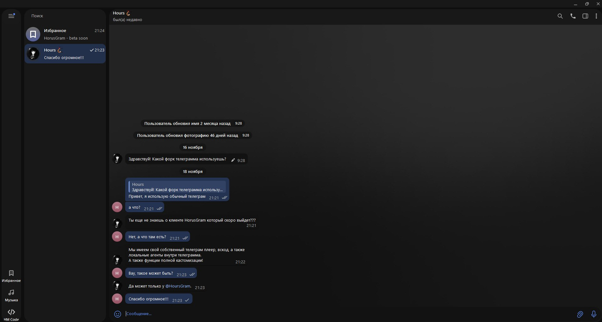

<p align="center">
  
</p>

<h1 align="center">HorusGram Desktop</h1>

<p align="center">
  <b>Telegram-клиент для тех, кому мало обычного Telegram.</b><br>
  Свой музыкальный плеер, редактор кода с ИИ-ассистентом и полная кастомизация — прямо внутри мессенджера.
</p>

<p align="center">
  <a href="https://t.me/HoursGram"></a>
  
  
  
  
  
</p>

<p align="center">
  <b>Русский</b> · <a href="README-EN.md">English</a>
</p>

<p align="center">
  
</p>

## Что такое HorusGram

HorusGram — нативный десктопный клиент Telegram на C++/Qt. Он работает с вашим обычным аккаунтом Telegram, но добавляет то, чего нет в официальном приложении: тёмный «графитовый» интерфейс, встроенный плеер, редактор кода и десятки настроек внешнего вида. Всё работает локально — клиент не собирает ваши данные.

## Возможности

### 🎵 Музыка
- Собственный плеер в отдельном окне — вкладка **«Музыка»** на боковой панели
- Плейлисты и очередь воспроизведения
- Построчные тексты песен (LRCLIB, Kugou, NetEase)
- 5-полосный эквалайзер с пресетами
- «Волна» — то, что сейчас в тренде на SoundCloud

### `</>` HM Code
- Редактор кода в отдельном окне — вкладка **«HM Code»** на боковой панели
- Работа с файлами в выбранной вами папке
- ИИ-агент Manul прямо внутри Telegram

### 🎨 Кастомизация
- Графитовый интерфейс со скруглёнными элементами и шрифтом Montserrat
- Свой раздел **«Кастомизация»** в настройках: палитра, оформление, тема в стиле macOS
- Видео вместо фона чата — с размытием и затемнением
- «Матовое стекло» при просмотре медиа
- Собственный курсор

### 💬 Чаты
- Скрытие чатов до перезапуска или в папку под паролем
- Отправка любого видео как кружка
- Копирование фото и файлов из сообщений в буфер — вставка сразу альбомом
- Выделение нескольких чатов сразу

## Скачать

Бета скоро. Следите за новостями в [@HoursGram](https://t.me/HoursGram).

## Сборка из исходников

```powershell
git clone --recursive https://github.com/plshours/HorusGram-Desktop.git horusgram
```

Дальше — по инструкции для своей системы: [Windows](docs/building-win.md) · [Linux](docs/building-linux.md) · [macOS](docs/building-mac.md).

## Лицензия и авторство

HorusGram — **неофициальный** клиент. Он не связан с Telegram FZ-LLC или Telegram Messenger Inc. и не одобрен ими; «Telegram» — товарный знак его владельца.

Проект распространяется под **GPLv3** и основан на чужом свободном коде, авторство которого сохранено:

| Проект | Автор | Лицензия |
|---|---|---|
| [Telegram Desktop](https://github.com/telegramdesktop/tdesktop) | © The Telegram Desktop Authors | GPLv3 с исключением OpenSSL ([LICENSE](LICENSE), [LEGAL](LEGAL)) |
| Десктопный форк, из которого взяты настройки и кастомизация | — | GPLv3; исходники в `Telegram/SourceFiles/ayu/` с оригинальными заголовками |
| [Telegram for macOS](https://github.com/TelegramMessenger/telegram-macos) | © Telegram FZ-LLC | GPL-2.0; используются только значения цветов для macOS-темы |
| [Montserrat](https://github.com/JulietaUla/Montserrat) | © The Montserrat Project Authors | SIL OFL 1.1 ([OFL.txt](Telegram/Resources/fonts/OFL.txt)) |

Подробнее — в [NOTICE.md](NOTICE.md). О приватности и использовании кода — в [PRIVACY_AND_CREDITS.md](PRIVACY_AND_CREDITS.md).
